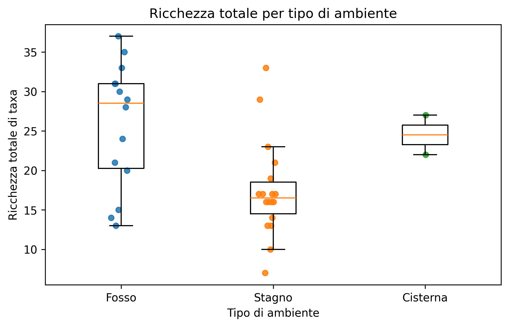
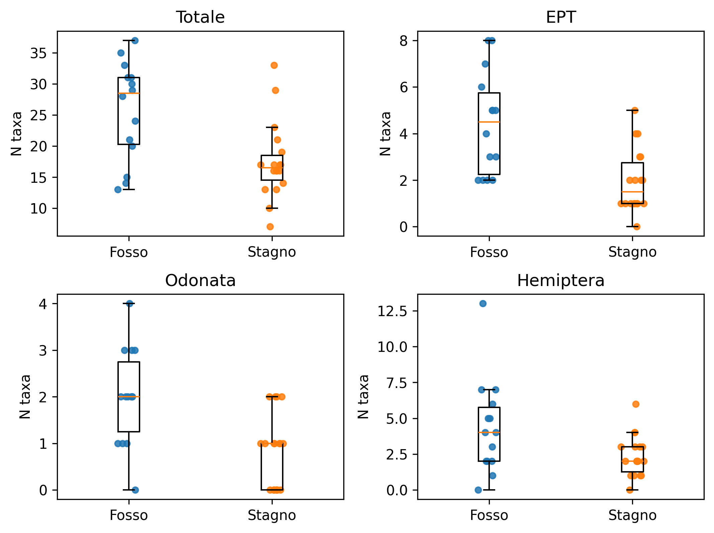
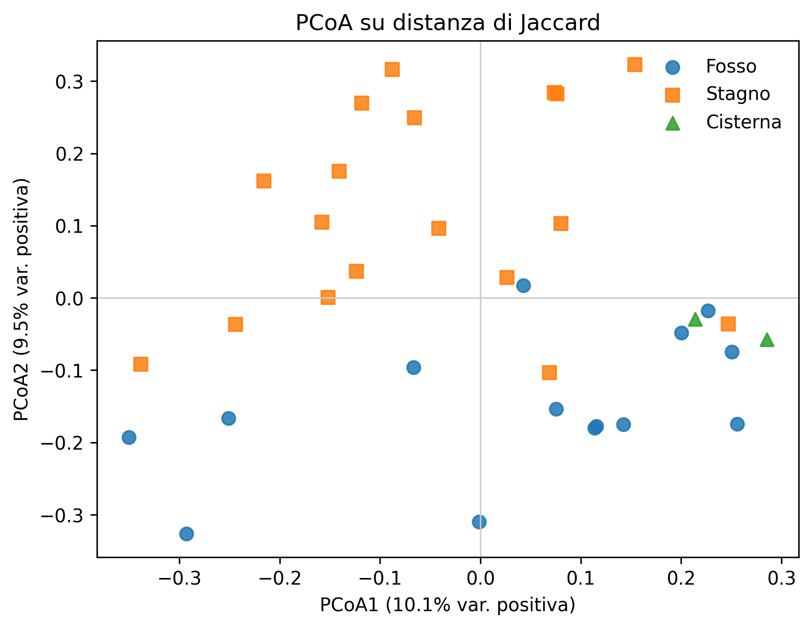
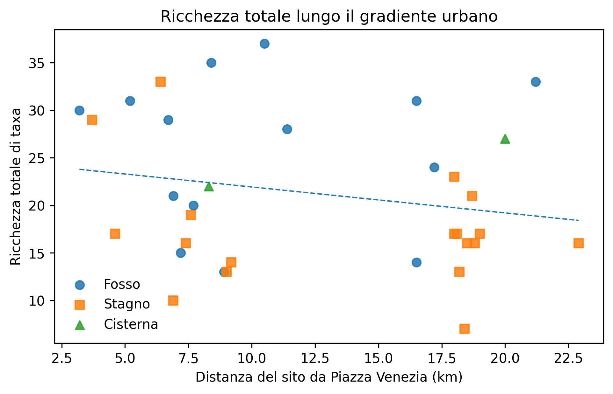

# Research Results

## Overview

This section summarises the main findings of my Master's thesis on aquatic insect biodiversity in the RomaNatura protected area system, using environmental DNA (eDNA) metabarcoding.

## Taxonomic Diversity

Environmental DNA metabarcoding targeting the COI and 16S mitochondrial markers detected a total of **183 aquatic insect taxa** across 34 freshwater sampling sites distributed among 11 protected areas.

These findings highlight the diversity of aquatic insect communities within Rome's urban and peri-urban freshwater ecosystems.

## Differences Between Aquatic Habitats

The research investigated differences in aquatic insect richness between ditches and ponds.

The statistical results indicated that ponds had approximately **31% lower expected taxonomic richness** compared with ditches.

These differences suggest that habitat characteristics may play an important role in shaping aquatic insect biodiversity.

## Community Composition

The research also examined variation in aquatic insect community composition across sampling sites and habitat types.

Multivariate statistical outputs were used to explore patterns of similarity and differences among aquatic insect assemblages.

## Urbanisation Gradient

The study investigated whether aquatic insect biodiversity was associated with an urbanisation proxy based on straight-line distance from Piazza Venezia, in central Rome.

The results did not identify a statistically significant relationship between this distance measure and aquatic insect taxonomic richness.

## Ecological Implications

The findings highlight the importance of considering local freshwater habitat characteristics when assessing aquatic insect biodiversity in urban protected areas.

They also support the potential value of environmental DNA metabarcoding as a tool for biodiversity monitoring and ecological research.

## Research Figures

### Figure 1 — Taxonomic richness across freshwater habitats

Comparison of aquatic insect taxonomic richness across the freshwater habitat types investigated in the RomaNatura protected area system.

### Figure 2 — Richness of selected aquatic insect groups

Comparison of taxonomic richness between ditches and ponds for selected aquatic insect groups, including EPT taxa, Odonata and Hemiptera.

### Figure 3 — Aquatic insect community composition

Principal Coordinates Analysis (PCoA) based on Jaccard dissimilarity, illustrating patterns of variation in aquatic insect community composition across freshwater habitats.

### Figure 4 — Richness and distance from central Rome

Relationship between aquatic insect taxonomic richness and straight-line distance from Piazza Venezia, used as a spatial proxy for urbanisation. No statistically significant association was identified in the study.

## Interpretation and Attribution

Statistical analyses and graphical outputs were produced within the ROMAeDNA research collaboration.

My contribution included experimental field and laboratory activities, ecological interpretation of the results, and scientific discussion within my Master's thesis.

Underlying datasets and graphical outputs are not included here pending confirmation of publication permissions.
